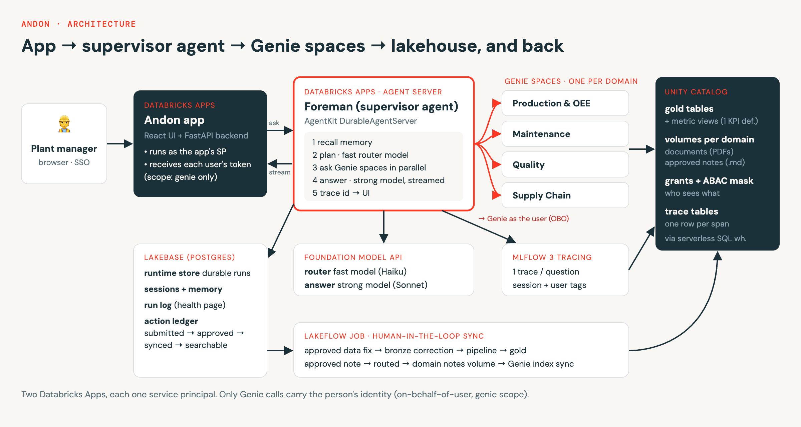

# Andon — a custom supervisor agent on the Databricks Agent Server, with human-in-the-loop feedback

**What this repository shows:** how to build a **custom supervisor agent** that routes questions across several
**Genie spaces**, hosted on the new **Agent Server** (AgentKit `DurableAgentServer`, GA) on Databricks Apps, and
deployed **without the Databricks Agent Bricks CLI**. The CLI is still Beta, so this is the interim, GA-only route
until it reaches GA. When it does, `agentbricks deploy` can replace the deploy notebook and the agent code stays as it is.

**The demo:** *Andon* is a manufacturing operations app for a fictional multi-plant manufacturer (KK's Parts). It works
as an add-on to existing systems. Plant managers and engineers see plant performance and ask **Foreman**, the
supervisor agent, questions that span production, maintenance, quality and supply chain. When they correct a value or
record a decision, a reviewer approves it, and the change flows back into the lakehouse. The next answer
reflects it: that's the **human-in-the-loop** feedback loop.

Everything uses GA or Public Preview features only.



**How a question flows:** the Andon app sends the question to Foreman. Foreman asks the right Genie spaces in
parallel, as the signed-in person, and streams its steps and answer back to the app. **How a decision flows back:**
the app writes the approved action to Lakebase. A scheduled job pushes it into the lakehouse: data fixes go to bronze,
then the pipeline, then gold; notes go to the domain's notes volume in its Genie space. From there the Genie spaces
use it, Foreman pulls it into answers, and the app shows it.

## Under the hood: Agent Server + Lakebase
Foreman's agent loop is plain Python (`04_supervisor_agent/agent/foreman.py`). The host is the AgentKit Python SDK
(`pip install databricks-agentbricks`, `import databricks_agentkit`) running as a Databricks App:

```python
from databricks_agentkit import DurableAgentServer, InvocationContext

app = DurableAgentServer()                 # the Agent Server: POST /api/invocations, durable runs

@app.invoke
async def invoke(input: dict, context: InvocationContext) -> dict:
    for event in AGENT.run(input["question"], session_id=context.session_id):
        await context.emit(event)          # each step is saved to the runtime store, then streamed
    return {"answer": ...}
```

| Under the hood | What it does |
|---|---|
| `POST /api/invocations` (stream) | The app starts a run and streams its events: "Asking Maintenance…", "querying: downtime by line", then the answer token by token. |
| Runtime store in **Lakebase** | Every run, event and result is stored in Postgres (schema `foreman_runtime`). A closed tab or a redeploy doesn't lose the answer: the app reconnects with `GET /api/invocations/{id}/events?after=N`. Retries with the same id never run twice. |
| No CLI | The deploy notebook gives the app a Lakebase `postgres` resource and sets `DATABRICKS_AGENTBRICKS_RUNTIME_STORE_LAKEBASE_ENDPOINT` + `DATABRICKS_AGENTBRICKS_RUNTIME_STORE_SCHEMA`. The SDK supports this pair in code, but the public docs describe only the CLI-provisioned store, so the SDK version is pinned. |
| Lakebase, other schemas | `foreman`: sessions, long-term memory, the run log behind the admin health page. `andon`: the human-in-the-loop action ledger. |
| Genie as the person | The Andon app asks for one user-authorization scope, `genie`. Each question's Genie calls use that person's token, so their Unity Catalog permissions apply. Everything else runs as the apps' service principals. |
| Traces | One MLflow trace per question, stored as Unity Catalog tables. |

## Build it
1. **Get the repo into your workspace.** Workspace → Create → Git folder → this repository's URL.
2. **Set up the demo in `config/`.** Open `config/demo_config.yml`, the one file you edit, and set at least:
   - `workspace.catalog`: a catalog you can create schemas in
   - `workspace.warehouse_name`: a serverless SQL warehouse (Medium or Large; the agent queries several spaces at once)
   - `governance.admin_email` and the demo persona emails under `governance.groups`
   - `supervisor.router_llm` / `answer_llm`: Foundation Model API endpoints available in your workspace

   `config/README.md` explains every setting, which are crucial and which optional. Before you run, as a workspace
   admin, enable the preview **Analyze Files in Volumes with Genie Agents**.
3. **Run `99_run_all`.** It checks your workspace (`config/00_preflight`), then builds every step in order. Each
   step is idempotent, and you can run it on its own. First run takes ~60–90 minutes.

| Step | Folder | Builds |
|---|---|---|
| 0 | `00_lakebase/` | The Lakebase project: the runtime store, sessions and memory, and the action ledger |
| 1 | `01_data_generation/` | Synthetic source-system data plus 40 domain documents (PDF) |
| 2 | `02_medallion_pipeline/` | Bronze → silver → gold, and metric views (one definition per KPI) |
| 2c | `02b_unity_catalog_governance/` | Groups, grants, and an ABAC column mask on confidential values |
| 3 | `03_genie_spaces/` | Four domain Genie spaces (from `spaces/*.yml`) with their documents and notes volumes, plus benchmarks |
| 4 | `04_supervisor_agent/` | **Foreman** on the Agent Server (Databricks App), then its evaluation |
| 6 | `06_human_in_the_loop/` | Correction tables, notes volumes, and the scheduled sync job (Lakebase → lakehouse → Genie) |
| 5 | `05_app/` | **Andon**, the app (FastAPI + React, Databricks App) |

4. **Open the Andon app** (the URL is printed by the last step). Each person authorizes it once on first visit.

**Good to know:** the Genie docs say content search stays in sync with the volume automatically. In our testing,
newly written note files weren't found until the index was re-synced. So the sync job triggers the index sync
itself after writing notes and records when each note becomes searchable.

## Build your own
`skills/` holds the pattern, written for any domain. Point an AI coding agent at it:
- `skills/build-agentkit-agent`: any custom agent on the Agent Server. Covers the SDK, the client protocol,
  the runtime store, identity, wiring Genie spaces together, tracing, deploying without the CLI, and evaluation.
- `skills/build-custom-supervisor`: a supervisor over Genie spaces, following this repo's layout.
